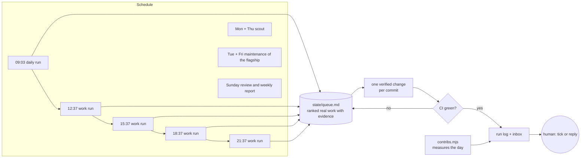

# Vibe coding, run as a system

> One person, an AI coding agent and a control repository that runs a portfolio of repositories end to end: it triages, fixes, tests, releases, researches new ideas and reports back. This repository documents how that works, what stops it from doing damage, and what it has really produced.

**Status: private draft.** Every number in [METRICS.md](METRICS.md) is generated from GitHub and the agent's own run log, never typed by hand. Nothing here is padded: the rules forbid it, and [the guardrails](docs/GUARDRAILS.md) explain why that matters more than a pretty contribution graph.

## At a glance

Generated from the configuration and GitHub by `scripts/showcase-sync.mjs`, so it cannot drift from what actually runs.

<!-- gen:glance -->
- **17** public projects and **4** private ones under care, each in the same care checklist; the one untouched longest is served first
- **5** scheduled runs a day (daily 09:03, work runs 12:37, 15:37, 18:37, 21:37); idea scouting Monday and Thursday 07:30
- **4** standing approvals granted by the owner (dependabotMerge, listPrsByContributing, closeAds, mitLicenseOwnRepos); everything else waits in the inbox
- New ideas start **private** (cap: 4 incubating projects) and become public only after the owner has looked at them
- Live numbers: [METRICS.md](METRICS.md) · every project: [PROJECTS.md](PROJECTS.md)
<!-- /gen:glance -->

## What this shows

| I can | How it shows here |
|---|---|
| Direct an AI agent as a team member, not as autocomplete | The [operating manual](docs/ARCHITECTURE.md) the agent reads before every run, and the playbooks per kind of run |
| Automate real workflows, not demos | Several scheduled runs a day, a ranked work queue built from CI, pull requests, issues, workflows and test gaps, a contribution counter, a weekly report |
| Keep an autonomous system safe | Hard rules, a lock against parallel runs, a secret scan before every push, private-first incubation, a human inbox for everything the agent may not decide alone |
| Ship software that holds up | Tests that must be able to fail, CI checked after every push, honest READMEs with limits, calibrated statistics |
| Measure instead of claim | [METRICS.md](METRICS.md), [case studies](docs/CASE-STUDIES.md) with the mistakes included |

## How a day looks

1. **Measure.** `contribs.mjs` counts the day against a target. The target is a yardstick for real work, never a quota.
2. **Find work.** `queue.mjs` reads CI state, open pull requests and issues, outdated actions, missing basics, TODO markers, modules without tests and the project roadmaps, and ranks it. Inside each priority the repository that was touched longest ago comes first, so every repository grows evenly. Every line carries its evidence.
3. **Do one thing properly.** One logical change per commit, verified by actually running it; a test is only accepted if it fails when the code is broken on purpose.
4. **Check.** Secret scan, push, CI result. A red run jumps to the top of the queue.
5. **Report.** A run log, an inbox in plain language for the decisions that belong to a human, and a weekly report.

## Read on

- [Architecture](docs/ARCHITECTURE.md): the control repository, state files, run types, the queue and the measurement
- [Guardrails](docs/GUARDRAILS.md): what the agent may never do, what it may decide alone, how that is enforced
- [Case studies](docs/CASE-STUDIES.md): what was built, how the agent worked, and where it was wrong and how that was caught
- [Projects](PROJECTS.md): every project with tier, description and latest release (generated)
- [Metrics](METRICS.md): generated numbers
- [Reproduce it](docs/REPRODUCE.md): the minimum you need to run the same setup

## Honest limits

- It is one person's setup on one machine: scheduled runs need the desktop app to be open, and usage limits cap how much work happens.
- An agent can be confidently wrong. The system limits the damage (checks, CI, an inbox for decisions) rather than pretending otherwise; see the case studies.
- Contribution counts depend on what GitHub shows: private repositories only count when the profile setting for private contributions is on.
- This is a draft until the owner has read it. It becomes public only through an explicit approval.

## Licence

MIT, see [LICENSE](LICENSE).
